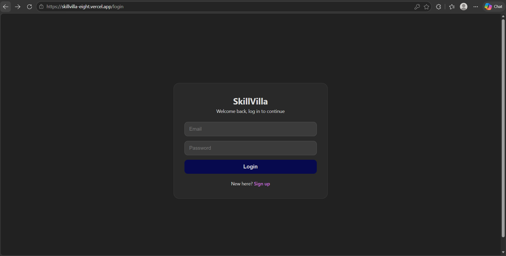
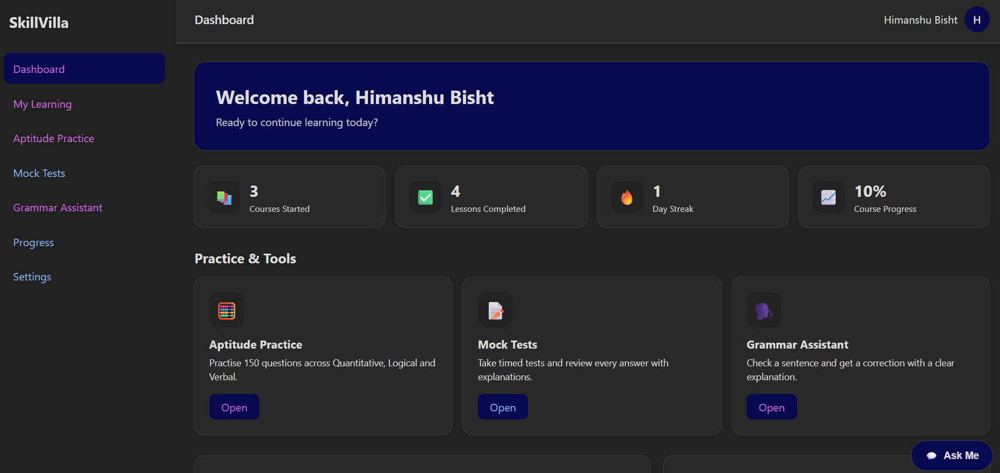
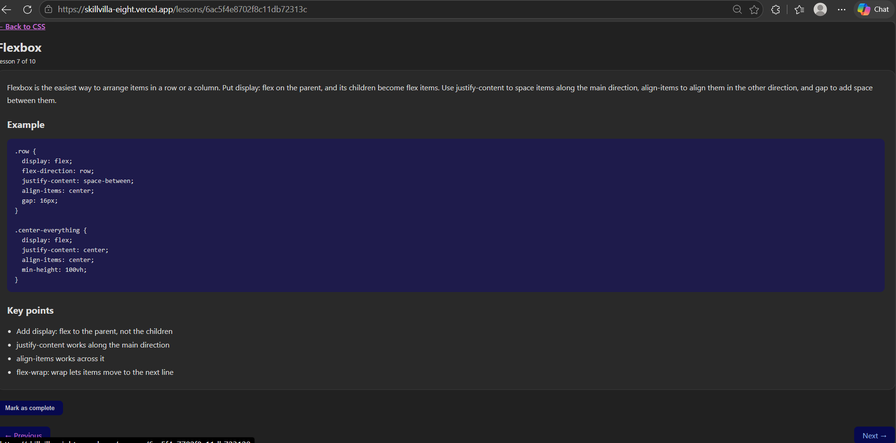
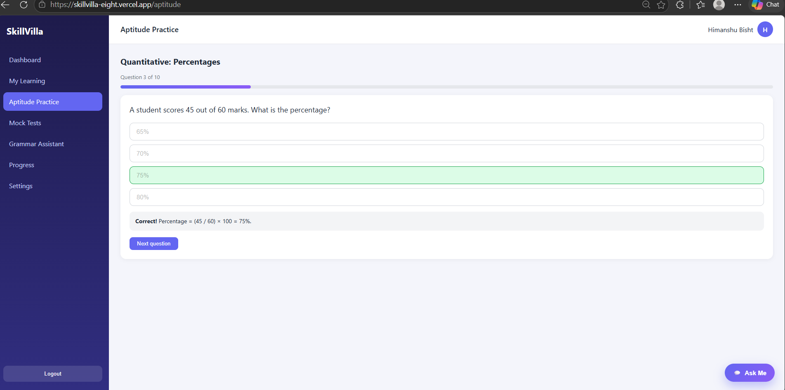
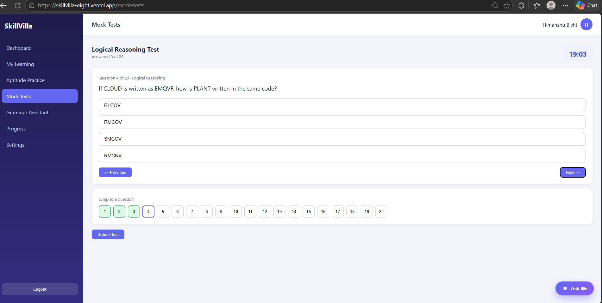
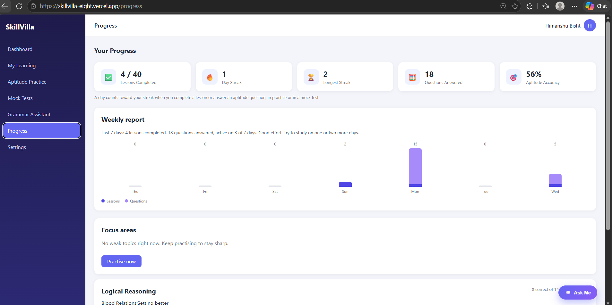

# SkillVilla

A full-stack MERN learning platform that helps students prepare for placements. Users study short HTML, CSS, JavaScript and English communication lessons, practise 150 aptitude questions, take timed mock tests, and track their progress and daily streak.

**Live demo:** https://skillvilla-eight.vercel.app
**Backend API:** https://skillvilla-api.onrender.com

> The Backend runs on a free hosting plan that goes to sleep when it is not used. The first request after a break can take about a minute to respond. Please wait, and then everything works normally.

## Features

- **Secure authentication:** signup and login with bcrypt password hashing and JWT tokens, plus reusable middleware that protects private routes
- **Courses and lessons:** 4 courses (HTML, CSS, JavaScript, English Communication) with 40 short lessons, each with an explanation, a code example and key points
- **Progress tracking:** mark lessons complete, see course progress bars, a daily streak and a longest streak
- **Aptitude practice:** 150 questions across Quantitative, Logical Reasoning and Verbal, with instant feedback and explanations
- **Mock tests:** 4 timed tests with a countdown, question palette, auto-submit, topic-wise results and a full answer review
- **Weak-topic insights:** each topic is rated Needs improvement, Getting better or Strong from the user's saved answers, using simple rules
- **Weekly report:** a 7-day activity chart and summary on the Progress page
- **Grammar Assistant:** the user types a sentence and gets a correction with a short explanation, using the Gemini API
- **Ask Me:** a floating chat widget with ready-made questions and prewritten answers (a guided Q&A, not AI)
- **Settings:** change name and password

## Tech Stack

| Layer | Technology |
|---|---|
| Frontend | React, Vite, React Router, Axios |
| Backend | Node.js, Express |
| Database | MongoDB Atlas with Mongoose |
| Authentication | JSON Web Tokens, bcryptjs |
| AI | Google Gemini API (`@google/genai`), used only for the Grammar Assistant |
| Hosting | Vercel (Frontend), Render (Backend) |
| Testing | Postman |

## Project Structure

```
SkillVilla/
├── package.json                    # Backend dependencies and start script
├── Backend/
│   ├── server.js                   # Entry point: loads env, connects DB, starts server
│   └── src/
│       ├── app.js                  # Express app, CORS and route mounting
│       ├── db/db.js                # MongoDB connection
│       ├── middlewares/            # auth.middleware.js (JWT check)
│       ├── models/                 # user, course, lesson, progress, question,
│       │                           # aptitudeAnswer, mockAttempt, aiUsage
│       ├── routes/                 # auth, course, progress, aptitude, mock,
│       │                           # insights, dashboard, settings, ai
│       └── seed/                   # seed.js (courses, lessons), seedAptitude.js
│                                   # and aptitude/ (one file per topic)
└── Frontend/
    ├── vercel.json                 # Lets page refreshes work on Vercel
    └── src/
        ├── main.jsx, App.jsx       # Entry point and routes
        ├── components/             # ProtectedRoute and dashboard components
        ├── pages/                  # Login, Signup, Dashboard, MyLearning,
        │                           # CourseDetails, Lesson, Aptitude, MockTests,
        │                           # SentenceChecker, Progress, Settings
        ├── data/                   # Ask Me questions and answers
        └── styles/                 # CSS
```

## Run It Locally

### Prerequisites

- Node.js 20 or newer
- A MongoDB Atlas cluster (or a local MongoDB)
- A Gemini API key (only needed for the Grammar Assistant)

### 1. Install

```bash
git clone https://github.com/TheHimanshuBisht/SkillVilla.git
cd SkillVilla
npm install
cd Frontend
npm install
```

### 2. Environment variables

Create `Backend/.env`:

```env
MONGO_URI=your_mongodb_connection_string
JWT_SECRET=a_long_random_secret_string
GEMINI_API_KEY=your_gemini_api_key
GEMINI_MODEL=gemini-3.5-flash
GEMINI_FALLBACK_MODEL=gemini-3.5-flash-lite
FRONTEND_URL=http://localhost:5173
```

Create `Frontend/.env`:

```env
VITE_API_URL=http://localhost:3000
```

Generate a strong JWT secret with:

```bash
node -e "console.log(require('crypto').randomBytes(64).toString('hex'))"
```

### 3. Load the content

From the `Backend` folder:

```bash
node src/seed/seed.js
node src/seed/seedAptitude.js
```

The first command loads the courses and lessons, and the second loads the 150 aptitude questions. Run them again whenever you edit the seed files.

### 4. Start both servers

Backend (from the `Backend` folder):

```bash
npx nodemon server.js
```

Frontend (from the `Frontend` folder):

```bash
npm run dev
```

Open `http://localhost:5173`.

## API Reference

Base URL: `/api`. Every route except signup and login needs the header `Authorization: Bearer <token>`.

| Area | Method and route | Purpose |
|---|---|---|
| Auth | `POST /auth/signup` | Create an account |
| Auth | `POST /auth/login` | Log in and receive a JWT |
| Auth | `GET /auth/me` | Current user |
| Courses | `GET /courses` | All courses with lesson counts |
| Courses | `GET /courses/:id` | One course with its lessons |
| Courses | `GET /lessons/:id` | One full lesson |
| Progress | `POST /progress/complete` | Mark a lesson complete |
| Progress | `GET /progress` | Progress, streak and totals |
| Progress | `GET /progress/activity` | Last 7 days of activity |
| Aptitude | `GET /aptitude/topics` | Categories and topics with counts |
| Aptitude | `GET /aptitude/questions` | Random questions without answers |
| Aptitude | `POST /aptitude/check` | Check an answer and save it |
| Mock tests | `GET /mock/tests` | Available tests |
| Mock tests | `POST /mock/start` | Start a timed test |
| Mock tests | `POST /mock/submit` | Grade a test and return a review |
| Mock tests | `GET /mock/history` | Recent attempts |
| Insights | `GET /insights/aptitude` | Topic-wise accuracy and remarks |
| Dashboard | `GET /dashboard/summary` | Continue learning and recent activity |
| Settings | `PUT /user/profile` | Change name |
| Settings | `PUT /user/password` | Change password |
| AI | `POST /ai/correct` | Grammar Assistant |

## How It Works

1. **Signup:** the password is hashed with bcrypt and the user is saved in MongoDB.
2. **Login:** the server compares the password hash and returns a JWT signed with `JWT_SECRET`.
3. **Private routes:** the Frontend sends the token in the `Authorization` header, and the auth middleware verifies it before the route runs.
4. **Aptitude and mock tests:** questions are sent without answers. The server checks the answers, so correct answers are never exposed to the browser.
5. **Insights:** every saved answer feeds a per-topic accuracy count, and plain rules turn it into a remark.


## Screenshots

### Login


### Dashboard


### Lesson


### Aptitude Practice


### Mock Test


### Progress



## Security Practices

- Passwords are hashed with bcrypt and hidden from queries by default
- Login returns the same message for a wrong email and a wrong password
- JWT-protected routes, with answers and secrets kept on the server
- CORS only allows the deployed Frontend and local development
- Secrets live in environment variables and are never committed
- The Grammar Assistant needs login, limits each sentence to 300 characters and each user to 15 checks a day
- Rate limiting on login (10 failed attempts per 15 minutes), signup and the whole API

## Author

**Himanshu Bisht**

- GitHub: [TheHimanshuBisht](github.com/TheHimanshuBisht)
- LinkedIn: linkedin.com/in/himanshu-bisht-031aa8330/

